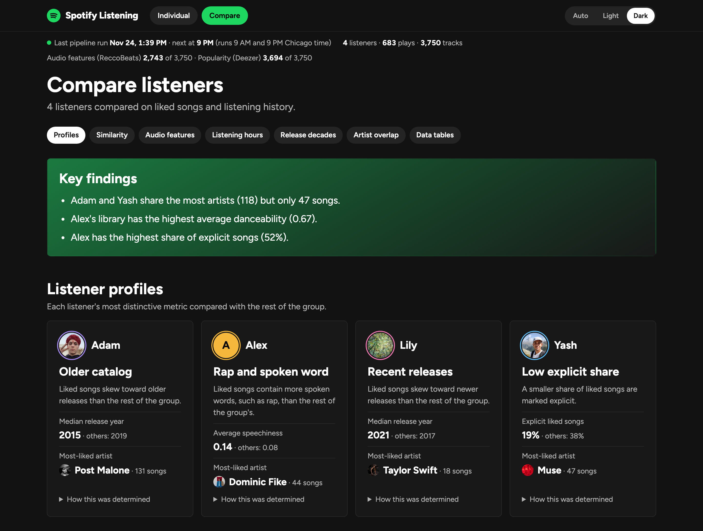
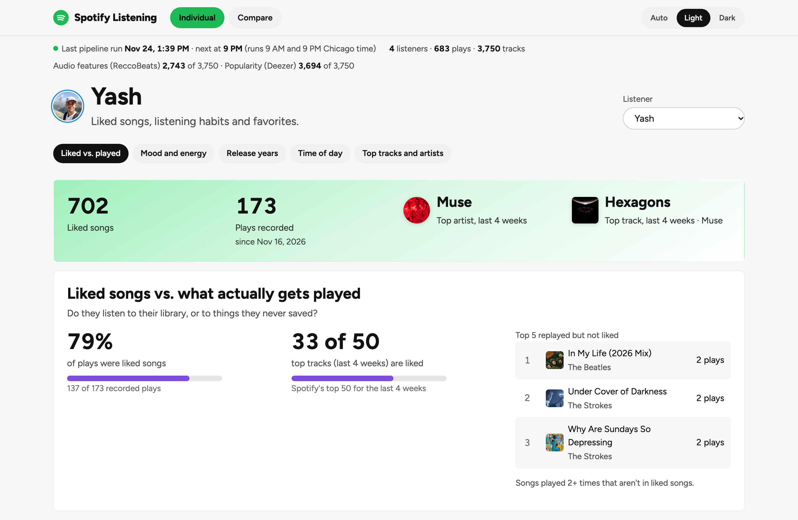
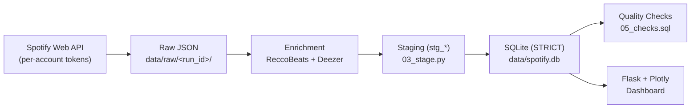

<div align="center">

# Spotify Listening Analytics

**Multi-account Spotify data pipeline, automated quality checks, and interactive listening dashboard.**


[Overview](#overview) · [Dashboard](#dashboard) · [Architecture](#architecture) · [Quick Start](#quick-start) · [Details](#under-the-hood) · [Structure](#project-structure) · [Team](#team)

<br />



</div>

---

## Overview

**Spotify Listening Analytics** continuously pulls listening history from multiple Spotify accounts, enriches every unique track with audio features and popularity metrics from third-party APIs, validates every load with SQL quality checks, and serves an interactive dashboard for exploring individual habits and group-wide taste comparisons.

- **Multi-account ingestion & enrichment:** Pulls up to 5 Spotify accounts into immutable raw JSON snapshots (`data/raw/<run_id>/`) and enriches each unique track once via ReccoBeats (audio features) and Deezer (popularity rank & fallback artist art).
- **Strict SQLite warehouse:** Stores 12 `STRICT` tables with append-only play/like history, idempotent metadata upserts, and a `dropped_rows` quarantine log for local files and out-of-range features.
- **Twice-daily Airflow orchestration:** Single-container Airflow 3.3.2 Docker setup running `ingest → create_tables → stage → clean → check` at 9:00 AM and 9:00 PM Chicago time (`0 9,21 * * *`).
- **Statistical & visual dashboard:** Zero-build Flask + Plotly web app with Auto / Light / Dark themes, Individual listening trends, and Compare views powered by Cliff's delta and Cohen's *h*.

## Dashboard

- **Compare (`/compare`):** Distinctive listener profiles, pairwise similarity scores and head-to-head comparisons, audio feature radars, 24-hour listening clocks, release decades & popularity spreads, an interactive artist overlap network, and expandable data tables *(shown above in Dark Mode)*.
- **Individual (`/individual`):** Listener summary, liked-vs-played breakdown with frequently replayed non-liked tracks, quarterly mood & energy trends, release-year and time-of-day distributions, and filterable top tracks/artists with day-over-day rank changes *(shown below in Light Mode)*.



## Architecture



| Layer | Technology | Role |
| --- | --- | --- |
| **Ingestion** | Python 3.13, `spotipy`, `requests` | Per-account Spotify pulls + one-time track enrichment (ReccoBeats & Deezer) |
| **Storage & Quality** | SQLite (`STRICT`), SQL | 12 normalized tables, append-only history, `dropped_rows` audit, 5 post-load checks |
| **Orchestration** | Apache Airflow 3.3.2, Docker | Twice-daily `spotify_daily` DAG with task-level timing and retries |
| **Dashboard** | Flask Blueprints, Jinja, Plotly | Read-only local web app with Auto / Light / Dark themes and no frontend build step |

## Quick Start

### Just want to open the dashboard?

The dashboard reads `data/spotify.db` read-only and requires no API keys or Airflow:

```bash
python -m venv .venv && source .venv/bin/activate
pip install -r requirements.txt
python dashboard/app.py
```

Open `http://127.0.0.1:5000`.

### Run the full pipeline

1. **Create a Spotify Developer app** in the [Spotify Developer Dashboard](https://developer.spotify.com/dashboard) with redirect URI `http://127.0.0.1:8888/callback`, and add each listener's Spotify email under **User Management** (up to 5 accounts in Dev Mode).
2. **Configure credentials & install dependencies:**
   ```bash
   cp .env.example .env          # add SPOTIFY_CLIENT_ID and SPOTIFY_CLIENT_SECRET
   python -m venv .venv && source .venv/bin/activate
   pip install -r requirements.txt
   ```
3. **Authenticate each account once:**
   ```bash
   python src/login.py <name>            # local browser login
   python src/login.py <name> --remote   # prints an auth link for a remote teammate
   ```
4. **Run manually or schedule with Airflow:**
   ```bash
   # One-off full run
   python src/pipeline.py

   # Or run twice daily via Docker + Airflow (UI at http://localhost:8080, unpause spotify_daily)
   docker compose up -d --build
   ```

## Under the Hood

<details>
<summary><strong>Data Model (12 STRICT SQLite tables)</strong></summary>

| Table | Purpose | Load Strategy |
| --- | --- | --- |
| `users` | Connected Spotify profiles (`first_name`, `last_name`, `image_url`, `country`) | Upsert (preserves known names) |
| `albums` | Album metadata, release year/precision, cover art URL | Upsert |
| `artists` | Artist metadata & photo URL (Spotify primary, Deezer fallback) | Upsert |
| `tracks` | Track metadata, duration, explicit flag, ISRC | Upsert |
| `track_artists` | Ordered many-to-many track-to-artist credits | Insert or ignore |
| `plays` | Append-only recently played history tagged with `run_id` | Insert or ignore |
| `saved_tracks` | Liked songs with `added_at` timestamp | Insert or ignore |
| `top_tracks` / `top_artists` | Daily top-50 snapshots across `short_term`, `medium_term`, `long_term` | Insert or ignore |
| `audio_features` | ReccoBeats track features (`valence`, `energy`, `danceability`, `tempo`, etc.) | Upsert (range-checked) |
| `deezer_tracks` | Deezer popularity rank & BPM matched by ISRC | Upsert |
| `dropped_rows` | Quarantine log for local files and out-of-range audio features | Insert or ignore |

</details>

<details>
<summary><strong>Automated Data Quality Checks (5 checks)</strong></summary>

`src/05_checks.sql` runs automatically after every load and fails the run if any check returns non-zero:

1. **Referential integrity:** no foreign key points to a missing parent row (`pragma_foreign_key_check`).
2. **Artist completeness:** every stored track has at least one row in `track_artists`.
3. **Timestamp validity:** no `plays` or `saved_tracks` timestamps are in the future.
4. **Play-window overlap:** detects if an account returned 50 all-new plays when prior history exists (indicating plays were missed between pulls).
5. **Account coverage:** fails if any account already in `users` was skipped during ingestion (e.g., due to an expired token).

</details>

<details>
<summary><strong>CLI & Offline Rebuild Commands</strong></summary>

```bash
python src/pipeline.py                     # full pull, stage, clean, and check
python src/pipeline.py data/raw/<run_id>   # rebuild SQLite from saved raw JSON (0 API calls)
python src/pipeline.py create_tables       # run a single step (create_tables | stage | clean | check)
python src/pipeline.py check               # run quality checks and print row counts
docker compose down                        # stop Airflow container
```

</details>

<details>
<summary><strong>API Constraints & Privacy</strong></summary>

- **Spotify Development Mode:** Spotify Dev Mode does not return genres, audio features, or track popularity (enriched instead via ReccoBeats and Deezer where available), caps recently played at 50 tracks per pull, and allows up to 5 registered accounts.
- **Time zones:** All timestamps are stored in UTC and converted to `America/Chicago` for daily snapshots, Airflow scheduling, and dashboard charts.
- **Privacy:** `.env`, `tokens/`, and `data/` are gitignored so credentials, OAuth refresh tokens, and personal listening data never enter version control.

</details>

## Project Structure

```text
.
├── DAG/
│   └── spotify_daily.py       # Airflow DAG (twice-daily 9 AM & 9 PM CT)
├── src/
│   ├── login.py               # Per-account OAuth login helper (local & remote)
│   ├── 01_ingest.py           # Spotify, ReccoBeats, and Deezer ingestion
│   ├── 02_schema.sql          # STRICT SQLite schema (12 tables)
│   ├── 03_stage.py            # Raw JSON to stg_* staging tables
│   ├── 04_clean.sql           # Cleaning, deduplication, upserts, and quarantine
│   ├── 05_checks.sql          # Post-load data quality checks
│   └── pipeline.py            # CLI entrypoint (full run, rebuild, or single step)
├── dashboard/
│   ├── app.py                 # Flask entrypoint & pipeline status strip
│   ├── db.py                  # Read-only SQLite helpers
│   ├── views/                 # Blueprints (individual.py, compare.py)
│   ├── templates/             # Jinja templates (base, individual, compare)
│   └── static/                # Shared theme tokens, CSS, and Plotly helpers
├── assets/                    # Dashboard screenshots for README
├── Dockerfile                 # Airflow 3.3.2 (Python 3.13) + pinned packages
├── docker-compose.yml         # Single-container Airflow setup
├── requirements.txt           # Pinned Python dependencies
└── .env.example               # Template for Spotify app credentials
```

## Team

Alex Miller · Gloria Ye · Lily Trautman · Yash Ahlawat
