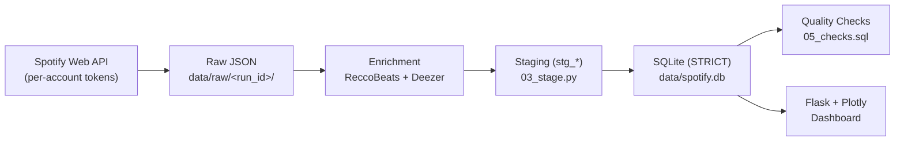

# Spotify Listening Pipeline & Dashboard

End-to-end data pipeline and analytics dashboard built for **MLDS 400 (Topics in Data Engineering)** at Northwestern University (Fall 2026). The pipeline ingests multi-account listening history from the Spotify Web API, enriches tracks with audio features from ReccoBeats and popularity ranks from Deezer, validates data quality on every run, and powers an interactive Flask dashboard.

## Architecture



- **Orchestration:** Apache Airflow 3.3.2 (`DAG/spotify_daily.py`) runs `ingest >> create_tables >> stage >> clean >> check` twice daily at **9:00 AM and 9:00 PM Chicago time** (`0 9,21 * * *`) inside a single Docker container (`airflow standalone`).
- **Reproducibility:** Every run writes raw API responses under `data/raw/<run_id>/` so the database can be rebuilt offline without repeating API calls.

## Data Sources & Model

| Source | Data Collected | Notes |
| --- | --- | --- |
| **Spotify Web API** | Profiles, recently played (last 50), liked songs, top tracks & artists (`4 weeks`, `6 months`, `1 year`), album & artist artwork | Requires a Spotify Developer app (up to 5 accounts in Dev Mode) |
| **ReccoBeats API** | Audio features (`danceability`, `energy`, `valence`, `acousticness`, `speechiness`, `instrumentalness`, `liveness`, `tempo`, `loudness`, `key`, `mode`) | Keyless; fetched once per unique track |
| **Deezer API** | Popularity rank, BPM, and fallback artist photos matched by ISRC | Keyless; fetched once per unique track |

Data is stored in `data/spotify.db` across 12 `STRICT` SQLite tables (`users`, `albums`, `artists`, `tracks`, `track_artists`, `plays`, `saved_tracks`, `top_tracks`, `top_artists`, `audio_features`, `deezer_tracks`, `dropped_rows`). History tables are append-only (`INSERT OR IGNORE`), descriptive tables upsert latest metadata, and local files or out-of-range audio features are logged to `dropped_rows`.

### Automated Data Quality Checks

`src/05_checks.sql` runs at the end of every load and fails the run if any check returns non-zero:

1. Foreign key integrity (`pragma_foreign_key_check`).
2. Every track has at least one credited artist.
3. No plays or likes carry future timestamps.
4. Per-account play-window overlap (flags gaps beyond Spotify's 50-play recently played cap).
5. Every user already in `users` was pulled in the current run.

## Dashboard

A read-only Flask + Plotly app (`dashboard/`) supporting **Auto / Light / Dark** themes:

- **Individual tab (`/individual`):** listener summary, liked-vs-played share and frequently replayed non-liked songs, quarterly mood & energy trends, release-year and hour-of-day distributions, and filterable top tracks/artists with day-over-day rank changes.
- **Compare tab (`/compare`):** distinctive listener profiles, pairwise similarity scores and head-to-head comparisons (using Cliff's delta and Cohen's *h*), audio feature radars, 24-hour listening clocks, release decades and popularity spreads, an interactive artist overlap network, and expandable data tables.

## Quick Start

### 1. Prerequisites

- Python 3.13 (Docker is optional, for scheduled Airflow runs).
- A [Spotify Developer Dashboard](https://developer.spotify.com/dashboard) app with redirect URI `http://127.0.0.1:8888/callback` and each listener's Spotify email added under **User Management** (up to 5 accounts).

### 2. Configure & Install

```bash
cp .env.example .env          # add SPOTIFY_CLIENT_ID and SPOTIFY_CLIENT_SECRET
python -m venv .venv
source .venv/bin/activate
pip install -r requirements.txt
```

### 3. Authenticate Accounts (Once per Listener)

```bash
python src/login.py <name>            # local browser login
python src/login.py <name> --remote   # prints an auth link for a remote teammate
```

Tokens are saved to `tokens/<name>.json` and refreshed automatically on subsequent runs.

### 4. Run the Pipeline

```bash
python src/pipeline.py                     # full pull, stage, clean, and check
python src/pipeline.py data/raw/<run_id>   # rebuild database from saved raw files (no API calls)
python src/pipeline.py check               # run data quality checks only
```

### 5. Run Scheduled with Airflow (Docker)

```bash
docker compose up -d --build
```

Open `http://localhost:8080` and unpause `spotify_daily`. Stop the container with `docker compose down`.

### 6. Launch the Dashboard

The dashboard only needs `data/spotify.db` (no API keys or Airflow required):

```bash
python dashboard/app.py
```

Open `http://127.0.0.1:5000`.

## Project Structure

```text
.
├── DAG/
│   └── spotify_daily.py       # Airflow DAG (twice-daily 9 AM & 9 PM CT)
├── src/
│   ├── login.py               # Per-account OAuth login helper
│   ├── 01_ingest.py           # Spotify, ReccoBeats, and Deezer ingestion
│   ├── 02_schema.sql          # STRICT SQLite schema (12 tables)
│   ├── 03_stage.py            # Flatten raw JSON into stg_* tables
│   ├── 04_clean.sql           # Clean, deduplicate, and upsert into final tables
│   ├── 05_checks.sql          # Automated post-load data quality checks
│   └── pipeline.py            # CLI entrypoint (full run, rebuild, or single step)
├── dashboard/
│   ├── app.py                 # Flask entrypoint and pipeline status strip
│   ├── db.py                  # Read-only SQLite helpers
│   ├── views/                 # Flask Blueprints (individual.py, compare.py)
│   ├── templates/             # Jinja templates (base, individual, compare)
│   └── static/                # Shared theme CSS and Plotly helpers
├── Dockerfile                 # Airflow 3.3.2 (Python 3.13) + pinned packages
├── docker-compose.yml         # Single-container Airflow setup
├── requirements.txt           # Pinned Python dependencies
└── .env.example               # Template for Spotify app credentials
```

## Data Notes & Privacy

- **Spotify Development Mode limits:** genres, audio features, and track popularity are unavailable from Spotify in Dev Mode (filled via ReccoBeats and Deezer where matched); recently played returns up to 50 tracks per pull; apps are capped at 5 registered accounts.
- **Time zones:** timestamps are stored in UTC and converted to `America/Chicago` for daily snapshots, scheduling, and dashboard charts.
- **Privacy:** `.env`, `tokens/`, and `data/` are gitignored so API keys, OAuth tokens, and personal listening history never enter version control.

## Team

Alex Miller, Gloria Ye, Lily Trautman, Yash Ahlawat
